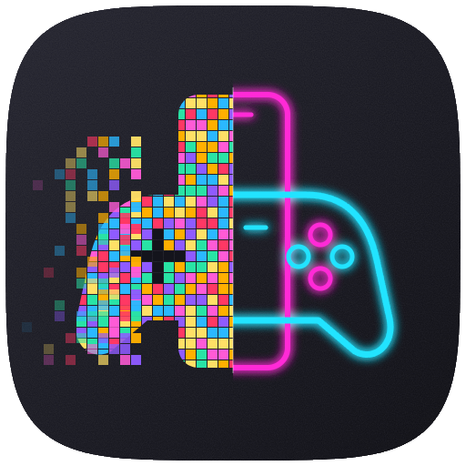

<p align="center"></p>

<h1 align="center">RetroVault</h1>

<p align="center">Flash, consolas retro, PSP y Nintendo DS en una sola app Android.<br>
<b>100% gratis · sin anuncios · funciona sin internet</b></p>

<p align="center"><a href="https://retrovault.retrovault.workers.dev">Página web</a> ·
<a href="../../releases/latest">Descargar APK</a></p>

---

## Sistemas

| Sistema | Emulador | Cómo corre |
|---|---|---|
| Flash (.swf) | [Ruffle](https://ruffle.rs) | WebAssembly |
| NES, SNES, Game Boy / Color / Advance, Genesis, Master System, Game Gear | [EmulatorJS](https://emulatorjs.org) + núcleos libretro | WebAssembly |
| PlayStation 1, Nintendo 64, Arcade (FBNeo), PC Engine, Atari 2600/7800/Lynx, Neo Geo Pocket, WonderSwan | EmulatorJS + núcleos libretro | WebAssembly |
| **PSP** | [PPSSPP](https://www.ppsspp.org) v1.20.4 | **Nativo** |
| **Nintendo DS** | [melonDS DS](https://github.com/JesseTG/melonds-ds) (libretro) | **Nativo** |

**RetroVault no incluye juegos.** Usa copias de seguridad de juegos que poseas legalmente.

## Cómo está hecho

- `index.html`, `play.html`, `db.js`: la biblioteca (IndexedDB) y la pantalla de juego. Carátulas de [libretro-thumbnails](https://github.com/libretro-thumbnails).
- `android/src/com/jugarswf/MainActivity.java`: muestra la web dentro de la app (WebView) servida desde el APK, sin internet.
- `android/src/com/jugarswf/DsActivity.java` + `android/native/rvlibretro.c`: reproductor libretro nativo mínimo para Nintendo DS.
- `android/ppsspp-retrovault.patch`: cambios sobre PPSSPP v1.20.4 para que RetroVault sea la pantalla de inicio y PPSSPP ejecute los juegos de PSP.
- `sitio/`: la página web (Cloudflare Workers).

## Compilar

En Windows, con PowerShell, git, Node.js y Python instalados:

```powershell
powershell -ExecutionPolicy Bypass -File android\build.ps1
```

La primera vez descarga Java, el SDK/NDK de Android y el código de PPSSPP (~8 GB en `C:\Users\<tú>\android-tools`) y compila todo (puede tardar una hora). Genera `RetroVault.apk`. Si no existe `android/jugarswf.keystore`, crea una llave nueva (que no podrá actualizar instalaciones firmadas con otra).

## Licencia

RetroVault se distribuye bajo **GPL-3.0** (ver `LICENSE`), porque incluye componentes GPL:

- PPSSPP — GPL-2.0 o posterior
- melonDS DS — GPL-3.0
- EmulatorJS y núcleos libretro — GPL-3.0 y licencias de cada núcleo
- Ruffle — MIT / Apache-2.0
- `android/native/libretro.h` — MIT

RetroVault es un proyecto independiente, no afiliado a Nintendo, Sony, Sega, Atari, SNK, Bandai ni a los proyectos citados.

## Apoyar

La app es y será siempre gratis. Si quieres apoyar el proyecto, en la [página web](https://retrovault.retrovault.workers.dev) está el enlace de donaciones. ❤
